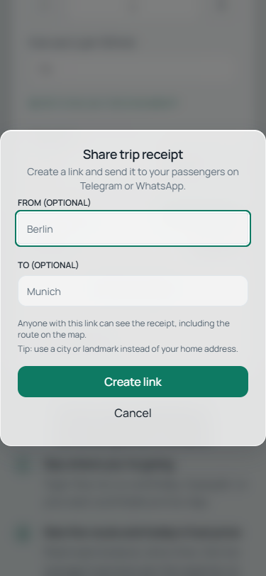

# UI/UX re-audit fixes — 19 October 2026

Base: `6d5d94a`. Branch: `codex/ui-ux-reaudit-2026-10-19`.
Validation used a local checkout and an isolated in-memory H2 database.
No production deployment or production data changes were performed.

## Implemented

| Audit item | Change |
|---|---|
| F5 | Shared 44 px touch-link utility for all footer links, city breadcrumb, AI privacy link and manual-planning link. The summary's live-price button is now 44 px. Existing settings live-price control already had a 44 px rule. |
| F10 | Shared money formatting in quick calculator, scenario results/deltas, receipts and city fuel-price facts; shared distance/duration in city facts; localized distance and date in Load dialog. Inputs keep raw editable numbers. Added a calendar-date formatter that avoids UTC day shifts. |
| F13 | Replaced all application `dark:` color overrides with semantic neutral/status utilities backed by the existing theme tokens. Migrated the remaining neutral icon colors and separator. Map route colors now read the accent token on initial load and theme changes. Added an ESLint rule rejecting new dark color overrides. Existing dynamic inline layout styles remain. |
| F14 | Server preloads seasonal hero images only on home and city-route pages. Shell regression verifies no hero preload on planner/dashboard. |
| F20 | Removed the duplicate Create new route quick action; the distinct quick calculator action remains. Receipt names already use Origin → Destination when both labels exist. Historical receipts without labels cannot be named reliably and remain unchanged. |
| N1 | Receipt loading, error and ready states have a main landmark and skip link. Every loaded receipt has an h1, including unnamed receipts. Route sketch has an accessible name; brand link is 44 px. Receipt formatting follows the receipt's effective language. |
| N2 | Result card shows departure date as a semantic time chip; weather shows its own forecast date. Legacy routes without a departure date reset to today instead of inheriting the previously opened trip's date. |
| N3 | Shared dark-green marker fill and white marker text tokens for map markers and waypoint badges. The route line uses the accent token. |
| N4 | Tablet scrim stays strong across the paragraph and brighter road/car region. Preserved seasonal artwork and responsive image selection. |
| N5 | Share dialog has a visible, 44 px Cancel action before and after receipt creation. |
| N6 | Loaded routes show a Saved price badge with the saved timestamp. Applying a live price or editing price/currency removes the badge; unrelated settings changes retain it. |

Browser tests also found and repaired an unnamed mobile account button when its avatar fails, insufficient contrast in receipt footer copy, and dark danger text on dashboard glass surfaces.

## Validation

- Production build: `npm run build` — passed.
- Frontend unit/component suite: `npm test` — **469 passed across 73 files**.
- ESLint: `npm run lint` — **0 errors**, 10 hook-dependency warnings in existing effects/callbacks.
- Token guard self-check: a dark color pair is rejected and a semantic utility is accepted.
- Server: `mvn -q -Dtest=SpaShellControllerTest test` — **34 passed**.
- Browser: `node node_modules/@playwright/test/cli.js test ux-reaudit.e2e.ts` — **10 passed**.
- Browser matrix: 375×812, 768×1024 and 1280×1024, light/dark. **48 page checks** cover EN/UK home and city route, dashboard, planner entry, receipt and 404. No horizontal overflow; one main, visible h1, skip link and 44 px footer/breadcrumb links. Zero violations of the selected axe rules: color-contrast, landmark-one-main, button-name and link-name.
- Additional Chrome checks: visible Cancel, Escape, focus restoration; saved price → live price; departure/forecast dates; guest manual planner and sample sign-in sheet. Saved-route external routing/fuel/weather and guest auth responses are simulated and explicitly named in the test.
- Interactive live Chrome pass confirmed the mobile dialog, all seven 44 px footer links, receipt formatting/main/skip link and tablet theme switching.

The tests wait for the real theme transition to finish before measuring contrast. Initial two-point receipt geometry was correctly stripped by existing privacy protection; the fixture includes intermediate route vertices so the retained sketch can be checked.

## Evidence

- [Mobile share dialog](share-mobile.png)
- [Planner departure date, forecast date and saved-price badge](planner-saved-price.png)
- [Tablet homepage](tablet-home.png)



## Limits and follow-ups

- No production deployment or production data changes. Browser-created receipts are isolated local H2 test data.
- No real paid AI request, named-car AI integration, Google OAuth round trip or NVDA/VoiceOver session was exercised. Guest auth and external routing/fuel/weather responses in the focused flow tests are simulated.
- Local Mapbox credentials were unavailable. Map tiles and real marker rendering were not live-verified; the planner evidence therefore shows its empty map canvas. Marker/badge token wiring is code-verified.
- Axe cannot establish photo-text contrast everywhere. The tablet scrim was visually inspected; this is not a claim of complete automated contrast coverage over the hero image.
- Full RoutePlanner decomposition and CI screenshot-baseline comparison were not bundled into this behavior/visual fix. The new repeatable browser suite saves screenshots and runs focused axe checks, but is not a pixel-diff baseline gate.
- Existing build warning about the large planner chunk remains. No dependency upgrades were made.

## Reproduce locally

Use an isolated local database, never production credentials:

```sh
mvn -Dspring-boot.run.profiles=dev '-Dspring-boot.run.arguments=--server.address=127.0.0.1 --spring.datasource.url=jdbc:h2:mem:uxaudit --spring.datasource.driver-class-name=org.h2.Driver --spring.jpa.database-platform=org.hibernate.dialect.H2Dialect --spring.session.jdbc.initialize-schema=always --spring.mail.username=local --spring.mail.password=local --app.admin.email=local@example.test' spring-boot:run
```

In `frontend/`, install the locked dependencies with `npm ci`, start `npm run dev`, and run the browser command above. The test uses an installed Chrome channel. It seeds disposable receipts and never deletes production records.
